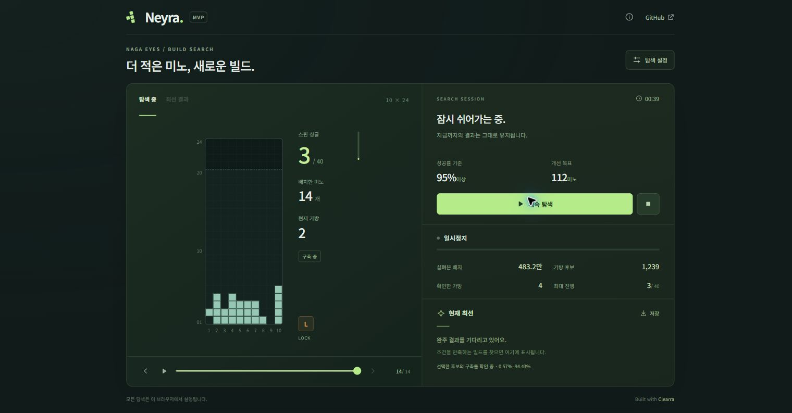

# Neyra

**더 적은 미노로 완주하는 새로운 Naga Eyes 빌드를 찾는 브라우저 탐색기.**

[Neyra 열기 →](https://daejunnom.github.io/Neyra/)

Rust/Wasm 탐색기와 Svelte 화면으로 구성됩니다. 빈 필드에서 O를 제외한 40번의 스핀 싱글을 목표로 탐색하며, 계산은 브라우저의 Web Worker에서 실행합니다.



## MVP 범위

- **10×24 필드**, 중력 대기와 한 칸 낙하 없이 이동·회전·Sonic Drop으로 도달하는 배치. 실제 미노 셀이 상단을 넘으면 그 경로를 종료하며, 상단을 스핀 판정을 위한 벽으로 사용하지 않습니다.
- 가방별 고정 배치를 새로 만드는 **single-tiling 탐색**. 한 가방 안에서는 사용한 미노 집합별로 후보를 나누고, 일곱 종류를 배치한 경계에서 검증·확장합니다. 검증된 유망 경로를 우선 연장하고, 제한된 예산을 소진하면 다른 가방 경계로 돌아갑니다. 기존 빌드나 반복 구조를 시작점으로 사용하지 않습니다.
- **실제 스핀 수 우선 순위**. 필드 상태가 매우 좋으면 한 번 적게 스핀한 준비 경로가 앞설 수 있지만, 두 번 이상 적게 스핀한 경로가 필드 점수만으로 앞서지는 않습니다. 완주 결과는 요청 성공률을 만족하는 실제 미노 수로 비교합니다.
- **스핀 싱글 전용 구조 평가**. 목표 미노가 들어갈 빈 공간과 필요한 받침을 만들고, 가방 말 후보에서 실제 입력으로 이어지는 짧은 후속 스핀 경로를 확인합니다. 계획 없이 새로 묻힌 빈칸은 다음 가방에서도 평가에 남습니다.
- 제안한 배치의 가능한 실행 순서와 홀드를 검사하는 **정확한 P7 검증**. 가방의 5,040개 순열을 확인하고, 검증 결과를 JSON에 보존합니다.
- 마지막 가방의 일부 미노만 쓰는 완주를 허용하며, 사용 미노 수에 따른 성공률을 평가합니다.
- **독립적인 병렬 탐색**. 자동 설정은 브라우저가 보고한 논리 코어 수를 사용하며, 1–128개를 직접 지정할 수 있습니다. 빈 필드의 최초 배치를 worker별로 나누고, 중앙·좌측·우측·넓은 작업 공간 프로필을 순환 배정합니다. 계산 사이의 타이머 대기를 제거하고, 재생 기록은 필요한 화면에만 전달합니다.
- 현재 가방 후보·검증된 최고 스핀 경로·기준을 만족한 완주 결과를 구분합니다. 화면의 중간 최고 경로는 **실제 누적 스핀 수**, 적은 배치 수, 높은 성공률 순으로 보관하며 필드 평가로 내려가지 않습니다. 일시정지·재개·중지·배치 재생·JSON 저장을 지원합니다.

새 설정의 기본값은 **성공률 100%, 목표 119미노**입니다. 사용자가 저장한 설정은 유지하며, 최소 성공률·목표 미노 수·탐색 상한·시작 예산을 조정할 수 있습니다. 목표 미노 수는 개선 목표이며 합격 조건이 아닙니다. 목표보다 긴 완주도 성공률 기준을 만족하면 보관합니다.

같은 가방 깊이의 검증된 최선보다 3스핀 이상 뒤처지는 후보, 목표 예산에 필요한 누적 진척도보다 3스핀 이상 뒤처지는 후보, 회수하기 어려워 보이는 블록이 잔여 셀 예산을 크게 넘는 후보를 선택적으로 자릅니다. 첫 가방은 평균 진척도 계산에서 준비로 제외하고, 실제 스핀 기록이 개선되지 않으면 목표 예산을 사용자 상한까지 넓힙니다. 이는 유효한 경로도 놓칠 수 있는 휴리스틱이며 정확한 불가능 판정이나 P7 실패 인증이 아닙니다.

MVP의 후보 생성은 시간과 메모리를 제한하는 휴리스틱입니다. 완주 발견이나 전역 최적성을 보장하지 않으며, 탐색하지 못한 상태를 불가능으로 판정하지 않습니다. 같은 모양의 다른 타일링을 합치는 교차 배치, 미러 결합, 재시작 비용 가중치는 아직 포함하지 않습니다. P7 검증의 정확성은 구현한 24행 물리·홀드 모델과 해당 고정 배치에 대한 것입니다.

## 회전 규칙과 다음 탐색기

SRS+의 기준은 [공식 tetrio.js](https://tetr.io/js/tetrio.js)입니다. Clearra에서 원문과 대조한 fixture를 공유하고, `scripts/generate-srs-plus.py`가 Rust 테이블을 생성합니다. 원위치 회전을 포함하는 표준 7종의 **84개 전이**를 사용하며, I 180도는 두 후보, O 180도는 원위치 하나입니다. 원문의 SHA-256과 전이 순서를 fixture에 보존합니다.

이는 물리 회전 자료의 개수입니다. Clearra의 배치 탐색은 점유 셀이 같은 O 180도 간선을 생략한 기존 80전이 최적화를 유지합니다. Neyra도 O 스핀을 목표에서 제외하며, 검색용 O 후보는 대표 방향 하나로 축약합니다. 명시적 회전 재생과 원래 방향을 지정한 역방향 질의는 유지합니다. 물리 규칙 자료와 탐색의 동등한 상태를 구분합니다.

회전은 첫 번째 물리적 성공 후보를 선택합니다. 그 후보가 24행 사망 경계를 넘으면 경로를 종료하며, 뒤쪽 킥으로 대체하지 않습니다. 행렬의 빈 패딩은 실제 미노 셀로 계산하지 않습니다.

[v2 탐색 재설계](docs/SEARCH_REDESIGN_V2.md)는 구조 제약에 따른 후보 생성과 가방 경계 branch-and-bound를 정의합니다. 현재 주 제어기는 UCT에서 **유한 예산의 경로 우선 확장과 우선순위 재개**로 바뀌었습니다. [집중 탐색과 병렬 실행](docs/FOCUSED_SEARCH.md)에 공급 성공률 상한, 예산 배정, worker 간 결과 계약을 설명합니다. 여러 가방에 걸친 구조 제약 전파와 전역 최소성 증명은 여전히 구현 대상이며, 이 변경만으로 40스핀 완주 성능을 주장하지 않습니다.

## 정적 구조 평가

구멍·거의 찬 행·열린 통로 자체에는 보너스를 주지 않습니다. 열 아래 빈칸, 닫힌 공간, 덮인 깊이, 한 행에 흩어진 빈 구간과 표면을 감점하고, 이를 실제로 사용할 스핀 목표의 채움·비움·지지 조건을 별도로 평가합니다. 중앙 작업 공간과 필요한 지붕을 양옆 표면의 높이 차이와 구분합니다. 작업 공간의 열이나 폭은 고정하지 않습니다.

작업 공간은 위쪽에서 이어지는 몸통 크기의 여유와 폭·깊이로 찾습니다. 점 하나가 통과하는 연결과 미노가 사용할 여유를 구분하며, 가느다란 통로만 남은 공간이나 묻힌 빈칸에 연결된 블록을 따로 감점합니다. 초기 폭 선호는 3칸보다 4칸에 작은 우선권을 주며, 더 넓을수록 무조건 좋다고 보지 않습니다. 이는 조정 가능한 설계상의 휴리스틱이고 통계적으로 입증된 최적 폭은 아닙니다.

가운데에 세운 I가 새 돌출을 만드는 경우, 남은 미노 하나로 그 높이 차이를 줄일 기하학적 배치가 있는지 확인해 감점을 조절합니다. 가로 I·양끝의 세로 I·기존 골짜기를 채우는 I를 일괄 금지하거나, 수리 가능성이 있다는 이유로 구축률을 인정하지 않습니다.

완성 가방의 제한된 후보에서는 다음 가방 재고로 후속 수순을 검사합니다. 실제 스핀을 찾은 가지는 최대 일곱 배치까지 이어 보고 추가 예산을 주며, 검증된 가방에서 여러 스핀을 얻은 경계에도 더 많은 생성 예산을 배정합니다. 덮개가 열리는 것과 빈칸이 채워지거나 그 행이 지워지는 것을 구분하며, 해결되지 않은 빈칸은 전역 후보 순위에도 반영합니다. 이 수순은 기하학적 제안이며 **고정 가방의 P7 검증을 대체하지 않습니다**. 제한 안에서 수순을 찾지 못해도 불가능으로 판정하지 않습니다.

첫 가방에서는 미노별 독립적인 착지 공간과 적은 의존성을 먼저 확보합니다. 이후 가방에는 무클리어 전용 라운드를 강제하지 않습니다. 마지막 부분 가방은 목표를 달성하면 끝나며, 미래 스핀이나 특정 잔여 모양을 요구하지 않습니다.

중복은 고정 배치의 의미를 보존하는 범위에서 줄입니다. 잠금 뒤의 점유 셀과 스핀 결과가 같은 기하학적 제안은 합치지만, 같은 필드를 만드는 서로 다른 종류별 타일링은 별도 후보로 남깁니다. 정확한 회전 상태와 입력 경로는 물리·P7 검증에 계속 사용합니다.

[구조 평가 구현 설명](docs/STRUCTURAL_EVALUATION.md)에 Sarcelle·SAO에서 가져온 원리, 정확한 검증과 휴리스틱의 경계, 현재 제한을 정리했습니다. 정적인 특징과 규칙으로 계산하며 NNUE나 학습을 요구하지 않습니다. 계산 공유는 worker 내부의 실제 재사용과 비용을 확인해 선택하고, 전역 공유 DAG나 work stealing을 전제하지 않습니다.

## 개발

Node.js 24, pnpm 11.25.0, Rust 1.90.0과 `wasm-bindgen-cli` 0.2.104를 사용합니다.

```sh
npm install -g pnpm@11.25.0
rustup toolchain install 1.90.0 --profile minimal --target wasm32-unknown-unknown
cargo install wasm-bindgen-cli --version 0.2.104 --locked
pnpm install --frozen-lockfile
cargo test --locked
python3 scripts/generate-srs-plus.py --check
pnpm check
pnpm build:wasm
pnpm dev
```

개발 서버는 `http://localhost:4173`에서 열립니다. 정적 배포 빌드는 다음과 같습니다.

```sh
NEYRA_BASE_PATH=/Neyra pnpm build
```

출력은 `apps/neyra-web/build`입니다. `main`에 반영하면 GitHub Actions가 테스트·빌드를 거쳐 Pages에 배포합니다. 저장소 Pages 설정의 배포 원본은 **GitHub Actions**를 사용합니다.

## 라이선스

[MIT](LICENSE). Clearra의 킥 테이블과 GUI, Spilink에 포함된 Triangle.js의 규칙 자료를 활용했습니다. 원본 출처·적용 범위·라이선스 전문은 [THIRD_PARTY_NOTICES.md](THIRD_PARTY_NOTICES.md)에 있습니다.
