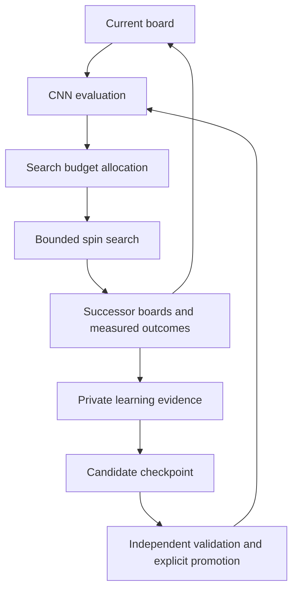

# Naga Eyes spin evaluator and observation analysis

Neyra separates public search from private CNN learning. Public GitHub Pages uses
the existing structural search evaluator. The developer-only learning Site uses
received bounded continuation observations to train an occupancy-only CNN.
It runs new continuation collection only when no received observations remain.

## Public search

- A fresh nonzero Web Crypto seed is generated on every page entry. A manually
  entered seed then remains reproducible for the run; saved seeds are not restored.
- Learning-data transmission defaults **off**, including when an old default-on
  preference is present. Only the current explicit, versioned consent enables
  transmission. Public learning is **off**. Old saved `cnn_evaluation` values do
  not enable it; a public CNN evaluator selector remains future work.
- Retained verified bag records may submit current rows, run/candidate identity,
  bag depth, seeds, rules, settings and a separate retained-path trace. These
  trace scores describe the heuristic search and never become CNN targets.
- With sharing on, selected verified boards after at least two bags seed the
  versioned v5 collector. Each job spends its work on one new inventory from
  one supplied board. Input-replayed result boards enter a bounded global frontier;
  later bag depth does not itself imply a more precise or preferable observation.
  At most three expensive collection jobs use the existing selected worker pool;
  no extra public pool is created. Across available depths, choose a
  nonempty equal-width evaluation band uniformly, then a node within it. Keep
  heuristic and CNN score units separate. Workers without an assigned collection job
  continue ordinary broad search, including while parent delivery is pending.
- A depth-specific cap no longer forces origin bags two and three out of the
  sampling pool. Bounded dispatch history survives consent toggles; evicted and
  unstarted work remains eligible. A zero-spin endpoint remains eligible for a
  later independent one-bag job. Depth needs actual whole-bag input witnesses;
  finite work cannot guarantee a later boundary from every input.
- A previous retained board may start a **new** job after consent. Previous
  traces are not backfilled. Turning sharing off invalidates in-flight results,
  aborts upload and clears queued collection across open tabs. The synchronous
  collector may finish its current bounded CPU call, but that output is dropped.
- At most eight jobs/awaiting observations share the collection capacity. A
  descendant is not dispatched until its parent has been acknowledged by the
  relay. Retries retain FIFO observations; saturation pauses allocation instead
  of dropping a parent. Each observation is at most 512 KiB, sent alone in a v4
  envelope. Existing v3 trace batches remain compatible and separately bounded.
- Frontier deduplication distinguishes queued proposals from dispatched jobs.
  Evicting an unstarted proposal does not mark it as explored; canonical identity
  chooses a stable queued representative without a depth preference. Successful observation uploads
  drain the FIFO immediately, while failures retain bounded retry backoff.
  Queued wire payloads are immutable serialized values with measured UTF-8 size.
- The endpoint checks exact policy, source identity, work accounting, witness
  links and physical lock/line transitions. These are structural checks, not a
  fresh SRS/P7 execution. Received evidence remains **client-reported**.
- Bag-depth best/runner-up selection lives at the board's lower right. Public
  selection lists all configured whole-bag depths, including empty depths above
  four. An empty choice says that no qualified candidate was found; it never
  displays a shallower board as if it belonged to the selected depth. Public
  construction-probability readouts are omitted; probability settings, ranking
  and certificates remain in force. The focused view distinguishes relative
  future spins from a complete path's progress toward 40 clears.

## Private developer learning

[Neyra Learning Studio](https://neyra-learning-studio.daejun0311.chatgpt.site)
is owner-private. Data provision and learning are fixed **on**; there are no mode
selectors. Start/pause controls bound work without changing those modes.
The browser must remain open for its learning workers to run. GPU learning is a
separate default-off hardware preference and can change during a session.

The studio imports full focused observations, queues them for analysis and uses
those supplied results directly. It records CNN predictions and observed targets
without relabeling every received board. Only an empty received queue and empty
remote relay permit fallback collection. Fallback starts at an actual submitted
result field or its input-reachable descendant, uses the explicit v5 collector,
and precisely measures its next bag. No opener/bootstrap/perturbation examples
are automatically selected. Old seeded-order artifacts remain in historical
exports, but are not mixed into the active fixed-policy training set.

The active corpus is `public-results-v1`. Historical examples are excluded from
active counts, previews, collection and training, while their immutable proofs
and snapshots remain available for old model provenance. Board identity includes
the corpus before canonical occupancy hashing. The corpus activation endpoint
first previews actual retained public records, then requires that preview digest
when applying the migration. It does not manufacture sources for old examples.

The CPU thread setting defaults to the browser's reported hardware concurrency
and accepts a manual limit up to 128. A reusable worker pool runs received
analysis and eligible fallback jobs in parallel. Analysis claims are batched up
to eight and expensive fallback claims are capped at three; an atomic claim keeps
one job from being assigned twice. Received work retains priority. Independent
workers retain separate engine instances and memories. Models and training data
are installed once per worker
for a cycle, and the validated Rust evaluator is reused for each unchanged model.
TensorFlow is loaded only when a worker receives an actual training request;
received analysis and fallback collection do not load the training runtime.

Training uses at most 20 attempted epochs per cycle, divided among CPU candidates
up to the selected thread count. Each candidate has at most ten epochs; a single
worker therefore retains the ten-epoch cap. GPU learning permits at most two
concurrent candidates. Every candidate starts from the same retained parent with
a different seed. Validation selects between candidates and the unchanged parent;
test labels do not choose a winner. Model records retain the actual worker,
backend, epoch allocation and training dataset provenance. A session continues
while work is available, in bounded units, and can be paused between units.

Sites D1 stores boards, source groups, fixed splits, observation indices, model
indices, training runs, search traces and decision records. R2 stores the full
observation witnesses, models and immutable export manifests.
A same-origin authenticated API supports collection, model uploads and complete
dataset exports.
Results may commit only while their matching lease is current. Accepting received
evidence and its training observation is transactional; late results cannot undo
quarantine or clear a replacement worker's lease. Occupancy deduplication returns
the immutable stored winner while preserving distinct received evidence records.
If parent storage succeeds but recorded child storage is interrupted, a missing
completion marker schedules idempotent repair from the persisted proof. Duplicate
receipts and bounded fallback preparation repair those exact fields; they do not
rerun search or replace the original lineage with a later submission.
Exports capture exclusions with their database bounds and overlap at most four
artifact reads without changing page order, cursors or content hashes.
The Site's existing service credential also permits agent uploads and readback;
it must never be copied into public code, command arguments, files or logs.

The served champion is pinned to `naga-spin-v2-f3194bf253a7`, independently of
newer private candidates. Training and uploads never promote a model automatically.
Legacy v2 retains its training-only data digest. V3 keys a bounded candidate
attempt by the eligible parent identity and the selected fixed-policy train and
validation records, so a changed validation set or quarantined parent cannot
reuse a stale selection result. Test and seeded records do not trigger fitting.
A v3 parent whose recorded fitting lineage is now excluded cannot seed another
candidate; its immutable artifact remains available. A paused session stays paused.

The learning worker is a build-emitted asset resolved against the live HTTPS
origin. It must not use a server module's `file://` URL as its base. A narrowly
scoped recovery releases old jobs failed by that specific Worker-construction
error, without resetting unrelated collector failures or active leases.

## Occupancy-only inference

The model has **33,442 parameters**, including **21,056** in the convolutional
extractor. Input is a `1 × 24 × 10` occupancy tensor, bottom row first.
The WASM `SpinEvaluator` owns one validated immutable checkpoint and can evaluate
many boards before disposal. Its raw prediction and summary share one forward
pass. The native evaluator also emits both results from that single pass.
The lexicographically smaller board/reflection is used for geometric invariance;
this does not claim identical mirrored physical supply coverage.

| Layer | Shape |
| --- | --- |
| 3×3 convolution + ReLU | 1 → 24, padding 1 |
| 3×3 convolution + ReLU | 24 → 32, padding 1 |
| 3×3 convolution + ReLU | 32 → 48, padding 1 |
| Average pooling | 6×5 → 48×4×2 |
| Dense + ReLU | 384 → 32 |
| Output | 32 → 2 |

The two outputs are `foundSpinLikelihood` and `observedSpins`. They estimate
discovery under the model's fixed finite observation policy. They are not P7
construction probabilities, proven maxima or impossibility judgments.

Rust evaluates the model using ordinary CPU arithmetic, including in WASM.
Offline PyTorch and the private TensorFlow.js workers default to CPU. The Site
can dynamically load its WebGL backend for GPU learning. Each active fit finishes
before a changed GPU preference applies to the next fit; initialization/runtime
failure retries on CPU from the retained start model. Rust placement search stays
on CPU. Native PyTorch supports optional CUDA and ONNX Runtime supports optional
CUDA inference with the drain/fallback boundaries described below.
Neither public search ordering nor its archive exports automatically invoke CNN
evaluation. `learnedOrdering.enabled` remains false for compatibility.

## Precise single-bag v5 observations

The active contract is schema 5, task `naga-next-bag-spin-v5`, policy
`precision-single-bag-spin-v5`. Both observation and prediction horizons are one
bag. The fixed budget is 524,288 declared work units, beam 48, profile 0, seed 1,
node cap 96 and one persistent attempt. Each unit is a complete reachable-lock
query for one unused piece on one state, one retained lock replay, or one contact
component target query. It is not the same unit as a legacy `GenerationJob.advance`;
equal numbers across those policies do not imply equal CPU time.

After reserving at most 4,096 units for component diagnostics and 256 for proof
replay, the remaining allocation stays with the supplied board's one inventory.
There are no second-bag arms. A beam per remaining inventory retains strong
prefixes and bounded randomized deferred alternatives. Up to 32 completed
physical witnesses are serialized independently of the live frontier. The
strongest observed spin prefix is saved before capacity trimming, so a better
field score cannot replace a higher actual count in the supervised target.

Within-bag future expansion is shared by identical **oriented occupancy and
remaining piece labels**, with dominance by actual spins already achieved.
Histories with different placement orders can share that future state. Reflection
is not used for physical expansion identity. A closed entry is inserted only
after all remaining-piece queries finish; an interrupted or discarded prefix
cannot claim work that was never performed. The record exposes physical and
order transpositions, closed-table evictions, frontier drops and work usage.
Exhausting a bounded frontier after dropping alternatives remains censored, not
a proof that the recorded maximum is globally optimal.

`refinement` schema 2 uses `spin-first-single-bag-transpositions-v1`, one root,
zero arms and contact diagnostics on at most three retained whole-bag candidates.
The diagnostic still cannot prune physical paths or become a training target.
Preprocessing creates one root `refined-next-bag-target` with work unit
`single-bag-expansion-and-input-verification-v5`. Preserve its exact policy,
budget, source hash, measurement group and replayed raw evidence. Never relabel
v2–v4 observations as v5, or fit raw proofs directly.

The CNN architecture and occupancy input are unchanged. Its v5 metadata records
`asymmetric-smooth-l1-v1`, count scale 6, underestimation weight 2 and overestimation
weight 1. With normalized count target `y` and raw prediction `p`, training uses
`0.25*BCE + SmoothL1(p,y) + SmoothL1(max(y-p,0),0)`. Both prediction directions
remain penalized. Validation reports MAE, mean deficit, mean excess and the
underestimate rate using the same clamped 0–6 count as Rust inference. These
measurements compare against observed search lower bounds, not unknown true optima.
The old v2–v4 objectives retain their original meaning. Private v5 initialization
may reuse v2 convolution/hidden features with a reset head and explicit provenance;
it stays untrained until an eligible grouped fit beats epoch zero.

## Preserved concentrated v4 observations and shared replay

Historical observations use schema 4, task `naga-next-bag-spin-v4`, policy
`concentrated-next-bag-spin-v4` and `config.observationVersion=4`. This versions
collection and preprocessing; it does **not** enlarge the CNN, change occupancy
inputs or add output heads. The fixed policy requests two inventories, 131,072
work units, beam 48, profile 0, seed 1, node cap 96 and at most sixteen attempts per phase.
V4 rejects a requested third inventory instead of recording an unmeasured horizon.

One observation concentrates on the supplied root and at most three first-bag
result boards. Each phase receives the same declared quota; a separate bounded
quota covers component-order diagnostics. Search candidates and the serialized
32-witness store are independent, so a full wire-proof store does not end the
remaining phase work. The bounded candidate reservoir retains distinct states
without a top-score cutoff. Divide its current-board scores into up to four
equal-width bands, draw a nonempty band uniformly and draw one node inside it.
Selected nodes are removed before the next draw. Keep the actual best prefix
separately from random proposals. Selection provenance and censoring counters
make these finite measurements inspectable; they do not prove a global maximum.

Each retained candidate has its exact oriented end field. A selected arm searches
one **new** inventory from that end field. Its local best spin count, deepest
prefix, queue, input paths, cleared rows, measured work and unfinished status are
recorded in top-level `refinement.arms`. `refinement.root` records the same local
information for the original input. `targets` remains the original root's one-bag
value. A second-bag gain is never folded into that root target. The original
two-bag path and zero-spin completed boundaries remain available for continuation.

Only learning uses the `touching-components-origin-only-v1` diagnostic. It groups
typed logical target cells by four-neighbor contact, then tests each component's
internal orders against the origin while other current-bag minos are absent.
`JO / TSZ / IL` therefore has at most `2! + 3! + 2! = 10` component orders. A larger
component uses at most 64 spread permutations under the remaining budget. Record
attempted/successful/interrupted orders and actual work. Their **sum is not P7 or
construction probability**: SRS+ kicks, line removal and access can link separated
components. This diagnostic cannot prune a physical path or become a CNN target.
The target still comes from full-board input replay.

Before fitting, turn each actually attempted root/arm into a
`refined-next-bag-target` with policy `best-replayed-next-bag-v1`. Keep its raw
observation ID, witness/arm reference, physical input, measurement group, exact
collector config and allocated-work scope. An unvisited candidate creates no
zero label. Within the same canonical board, policy and work scope, use the best
eligible measured representative; retain all raw evidence. Alternative path
counts are not summed, and heuristic quality or component scores never enter
the two supervised targets. Legacy v2/v3 rows keep their original semantics.

Training is a bounded replay cycle, not a whole-dataset fit for every arrival.
The private API atomically prepares at most 16 fresh eligible train winners and
48 random eligible historical train rows without replacement. At most 64 stable
validation rows select between candidates and the unchanged parent; test rows
are never sampled. First fitting needs four train rows and one validation row;
later fitting waits for a batch of sixteen newly eligible winners. Exact selected
IDs and order reproduce the chosen sample. The recorded seed controls training
shuffle, not SQLite's random selection.

Both preparation and completion recheck exclusions, split authority and parent
lineage. New evidence does not silently overwrite previous proofs. If a trained
ancestor later becomes ineligible, filtering the new batch cannot clean its
weights: use an eligible ancestor or an honestly untrained initializer and keep
the invalidated artifact for provenance. A v4 initializer may reuse the pinned
v2 convolution/hidden tensors only with reset output tensors and explicit
`targetDerivation` metadata. Actual grouped fitting is required before
`trained=true`; no private result automatically replaces the public champion.

Worker verification uses the agent's internal CPU workers and supported private
Sites service access or managed preview. Keep owner-only access intact. The user's
Chrome is a limited fallback only when internal access is unavailable.

## Preserved next-bag v3 observation contract

Historical v3 observations use schema 3, task `naga-next-bag-spin-v3`, policy
`bounded-next-bag-spin-v3`, and `config.observationVersion=3`. The target horizon
is explicitly `targetHorizonBags=1`. `config.horizonBags` and a model's
`horizonBags` continue to describe the **actual measured lookahead**, two or
three bags. These fields must not be confused. The fixed public/private policy
uses two bags, 131,072 work units, beam 48, profile 0, seed 1, node cap 96 and six
attempts per node. The labeling-source digest identifies the new collector.

One supplied nonempty field after at least two completed bags owns a job's
entire observation budget. Generation retains actual inventories, SRS+ inputs,
logical deletion context, Spin Singles and physical ceilings. It bypasses
completion pace, peer/sibling futility and all-supply quiet/P7-parent gates only
in this learning policy. Ordinary certified search retains its own gates.
Finite beam, exact continuation deduplication, node/witness capacity and work
budgets remain recorded censoring. Space is reserved for a parent-closed deeper
chain before accepting many shallow siblings. Quiet endpoints remain useful.

`targets` and `targetWitness` describe spins found **within the first new bag**.
`reachableWholeBagWitnesses` retains at most 32 parent-linked, replayed inventories,
including zero-spin results, each with all seven distinct labels, ordered
inputs, placed cells, row deletion context and frames. Its trust is
`input-reachable`: it proves a physical queue exists, not 5,040-supply coverage.
The legacy certified array stays empty for this policy. `measured.lookahead`
separately records requested/attempted/completed depth, reached locks, capacity
and duplicate limits, and one coherent best two-bag path with first/second gains.
Its total never becomes a one-bag training target. No result means unobserved,
not a proof that a board is impossible or a fabricated completed second bag.

After the parent receipt, its exact oriented result can seed the next job.
Thus a bag-two root can produce a bag-four origin, then bag six, without a
global completion candidate or all-supply certificate as the admission gate.
The source group and exact parent evidence travel with that continuation.
Received observations are consumed directly; only an empty received/relay queue
permits private fallback. Legacy v2 observations remain readable and archived
but do not enter v3 fitting. Exported training selections keep policies separate.

The public champion remains the unchanged v2 checkpoint. A private v3 training
initialization can reuse the explicitly identified convolution/hidden tensors
and reset the two output tensors to zero. It is schema 3 and `trained=false`,
not a relabeled v2 prediction. Only fitting actual, grouped v3 training records
can produce a trained v3 candidate; validation selects candidates and test
records remain untouched. Promotion is a separate decision. Rust/WASM accepts
both honest contracts and clamps a v3 predicted count to one bag (0–6).

The one-bag model is a deliberately short horizon. Actual two-bag paths preserve
preparation that pays off later, so a low first-bag prediction must not become
an unconditional prune. Future model-guided scheduling should first allocate a
nonzero observation floor, reserve second-bag work for promising setup results,
and use measured coherent gains plus a separately identified leaf prediction.
Only measured same-policy first-bag gains are supervised truth. Do not add a
leaf prediction to a target, count alternative paths together, or claim the
same remaining spins repeatedly. Adaptive allocation needs its own policy and
equal-work evaluation before public activation. See [checkpoint gates](LEARNING_CHECKPOINT.md).

## Preserved v2 observation contract

Schema 2 has task `naga-spin-observations-v2`. The normal policy is
`neyra-fixed-bag-continuation-v2`; exploration uses
`neyra-seeded-bag-continuation-v2` with an explicit seed, ordinal and
`proposal-order-only` scope. The legacy collector and its source digest remain
unchanged for reproducibility. These legacy policies accept current occupancy and provenance
from boundaries of at least two completed bags. Existing board scores, Terrain
scores, opener preferences, shape objectives and path-count targets are rejected.
The v2 model starts from fresh weights instead of a teacher-trained v1 checkpoint.

The labels are measured discovery of at least one spin and the observed count.
Input-reachable prefixes and exact P7/quiet-safe completed chains remain separate
in the evidence. Exhausted search is censored; an unobserved certificate maximum
stays unknown. Work, nodes, attempts, seed, horizon and labeling-source hash are
recorded so incomparable policies are not silently mixed.

Whole opener families and search runs remain in one train/validation/test split.
Descendants inherit their source group. Identical and reflected occupancy is
deduplicated within its corpus, while each stored physical witness retains its original
orientation. Checkpoint choice uses validation only; test records do not enter
gradient updates or browser checkpoint selection.

Retiring examples does not erase historical split constraints. A durable source
group is admitted before choosing a new hash split. If its first board belongs
to one unambiguous existing geometry component, the new group inherits that
component's split. Duplicate-only runs also retain their assignment and exact
physical source occurrence. Unconstrained components use deterministic hash
splits. Existing assignments are never moved. A real cross-split component
conflict still quarantines the affected group and descendants; historical
exclusions remain. Raw analysis evidence and physical orientations stay available.
V3 observations keep their actual `measurementGroup`, source and physical input,
even when an older run first registered the canonical occupancy. An excluded
first owner cannot permanently block an independent eligible observation in the
same unambiguous split. Immutable observations are retained per measurement group;
fitting selects the earliest eligible representative per canonical board and exact
policy. Eligible physical source occurrences also remain available to fallback
collection. Legacy v2 selection is unchanged. New snapshots record assignments,
source occurrences and exclusions explicitly.

Retained raw evidence is not automatically an authoritative split assignment.
An excluded active-corpus alias without a qualifying prior observation cannot
quarantine another new source. Legacy-corpus assignments remain authoritative.
An excluded active canonical owner's assignment remains an anchor only if that
board had an observation from the owner's own measurement group, or a legacy
NULL measurement slot, by the time of exclusion. An unrelated group's admission
does not confer authority on that owner. V3 sampling and counts use the actual
measurement group's durable split, even when the canonical occupancy alias was
first stored under an excluded owner's different split. A group's own observation
by the time of its exclusion preserves its historical membership, including when
another source owns the canonical alias. Genuine links between distinct
historical splits still quarantine the whole source run.

Current admission separates **retaining a result** from **using that field as a
supervised input**. A conflicting retained output blocks that exact measurement
group/board and its affected branch; it cannot taint unrelated inputs in the run.
An actual submitted/admitted root conflict remains a source-wide exclusion.
Analysis receipts read eligibility again after materializing descendants.

For an old exclusion provably caused only by an unadmitted output, the private
`admission/audit` route returns its immutable trigger evidence and a current
audit hash. `admission/recover` requires that hash, rechecks global split-anchor
authority atomically, records affected input blocks and appends a resolution.
It never removes the historical event or changes a source's split. Genuine
pre-exclusion supervised conflicts refuse recovery. Received-child admission
uses the server's verified parent chain so an unfinished parent materialization
cannot let a blocked branch enter fitting. Training/replay and parent model
eligibility all honor the same effective group and exact input filters.

The browser dataset has a bounded recent-plus-coverage sample per split, with
explicit total and selected counts. New observations can therefore enter training
after the dataset grows beyond the per-session capacity.

## Decision evidence and future search loop

The current intermediate model estimates **bounded short-horizon discovery**.
The future completion-oriented loop can use the same convolutional extractor,
while preserving the current checkpoint and its observation contract:



This diagram is the direction of development, not a claim that adaptive budget
allocation or a 40L value model is already enabled. Current public search keeps
its structural evaluator, probability admission, mino limits and existing budget.
Private labels also keep a fixed declared work budget so their targets remain
comparable. A private job records at most two CNN evaluations: its supplied board
and one selected successor. Predictions, allocated work, consumed work and actual
outcomes are stored separately with the model and policy identity.

Measured successor results may be associated with an ancestor only through exact
physical board matches and certified bag bridges. Client-supplied bridges retain
client-reported trust; they do not become independently verified by import. Feedback retains witness
references, actual spins and locks across at most six bridges. It is a censored
lower bound on an observed path, not an optimal completion value or a replacement
for the ancestor's original versioned target. Recording this feedback is distinct
from applying neural-network gradients; neither public heuristic scores nor
the CNN's own predictions become target truth.

For a future 40L cost head, the remaining required clears are known progress:
`remaining = 40 - completed`. Occupancy alone does not determine that progress:
two paths can reach the same board with different numbers of completed clears.
An estimate of minos needed to finish must therefore be conditioned on the
remaining target and the applicable rules. Training needs genuine completions
or an explicitly censored partial-observation objective; unfinished bounded
searches cannot supply exact completion costs. Until those contracts and
independent comparisons exist, keep the current mino-budget controls and avoid
adding ungrounded remaining-spin or completion-cost labels.

The retained v2 checkpoint can initialize a compatible private candidate without
discarding learned convolutional features. Future heads or a Transformer require
separate versioned contracts and sufficient independent evidence. No such
architecture change is required for collecting the present evidence.

## Reusable command-line tools

Build the release binaries with the repository's locked toolchain, then run the
commands with data and reports outside the repository:

```sh
cargo build --release --locked -p neyra-core --bins
python tools/learning/prepare.py --help
target/release/neyra-label --help
python tools/learning/train.py --help
python tools/learning/remote.py --help
```

`prepare.py` imports only deep occupancy/provenance, groups sources and removes
reflected duplicates. `neyra-label` collects new bounded continuations.
`spin_contract.py` validates observations, model dimensions and hashes.
`train.py` fits the network with CPU as the default and emits its model plus evaluation report.
`remote.py` uploads labels/models and checks the stored content by actual readback;
it also downloads full private snapshots, including proofs and search traces.
Use `NEYRA_SITE_URL` and `NEYRA_SITE_TOKEN` in the process environment for private
uploads. HTTPS certificate verification is required and redirects are refused.

The selected runtime checkpoint is
`crates/neyra-core/models/naga-spin-cnn-v2.json`. Its weight digest is SHA-256 over
the fixed sequence of float32 little-endian tensors, identified by
`sha256-f32le-neyraspin-v2`. JSON number formatting does not change that digest.
WASM exposes `evaluate_board`, `evaluate_board_model`, `spin_model_json`,
`label_board` and `label_board_exploration` for the private learning worker.

### Complete remote dataset refresh

The bounded browser training sample is not the export dataset. An export captures
committed rowid bounds and counts for the **active corpus** boards and labels, plus models,
training runs and traces. Later inserts appear in a new snapshot; earlier
snapshots remain available. Each new manifest records its corpus; manifests made
before corpus isolation retain their original meaning. Mutable job leases and retry counters are excluded.
Each manifest and page returns a SHA-256 of its exact UTF-8 bytes.

With the private URL/token already supplied through the process environment:

```sh
python tools/learning/remote.py sync --output /path/outside/repository/datasets
python tools/learning/remote.py pull --snapshot <snapshot-uuid> \
  --output /path/outside/repository/another-copy
```

The authenticated API is `POST /api/learning/exports`, followed by
`GET /api/learning/exports/{uuid}/manifest` and cursor pages at
`GET /api/learning/exports/{uuid}/page?kind=labels&cursor=0&limit=16`.
The downloader checks hashes, identity, cursor progress and final counts before
atomically updating `latest.json`. Partial downloads never become the latest
dataset; completed snapshot directories are never overwritten. Raw response
pages and per-kind JSONL files remain available for inspection. Fixed and seeded
labels are also written separately as `fixed-labels.jsonl` and
`exploration-labels.jsonl`; ordinary training uses only fixed labels. These derived
files honor the snapshot's effective `excludedTrainingGroups` and exact
`excludedTrainingInputs` group/canonical-board pairs. Historical exclusion events
and append-only resolutions remain audit evidence, not unconditional current
exclusions. Full `labels.jsonl`, raw pages and received artifacts remain
complete. V3 fixed-policy observations have their own `next-bag-fixed-labels.jsonl`
file. It selects one eligible canonical representative per exact policy without
discarding raw duplicate proofs; the receipt records those deduplicated counts.
V4 snapshots additionally preserve refined targets, immutable replay attempts
and the validation roster. The downloader verifies every derived target against
its full admitted raw proof, applies exclusions before choosing best eligible
representatives, and writes `refined-targets.jsonl` plus
`observations-index.jsonl`. `refined-observations.jsonl` preserves the v4 raw
collection policy separately. V5 uses `precision-observations.jsonl` and
`precision-targets.jsonl`, with the shared version-qualified proof index. Neither
raw v4 nor raw v5 observations can be fitted directly or mixed across policies.
The receipt also records eligible/excluded counts and derived file hashes.
Old snapshots without this optional exclusion list preserve their prior meaning.

For a bounded offline v5 experiment with sufficient independent data:

```sh
python tools/learning/train.py \
  --labels /path/outside/repository/precision-targets.jsonl \
  --proofs /path/outside/repository/observations-index.jsonl \
  --epochs 10 --threads 2 \
  --model-output /path/outside/repository/private-v5-candidate.json \
  --output /path/outside/repository/private-v5-training
```

The trainer samples at most 16 recent and 48 random historical train records,
retains a stable validation roster up to 64, records exact record/proof identities
and keeps held-out test evaluation separate from fitting and epoch selection.
Repeated `--proofs` can supply earlier immutable evidence when resuming a
compatible checkpoint. This explicit local invocation is not a Site replay
lease. V4/v5 candidates cannot bypass the private `training/prepare` and
`training/complete` authority through the generic model-upload command.

### Reusing a retained checkpoint

```sh
python tools/learning/train.py \
  --labels /path/outside/repository/fixed-labels.jsonl \
  --initial-model /path/outside/repository/parent-model.json \
  --initial-labels /path/outside/repository/parent-labels.jsonl \
  --model-output /path/outside/repository/candidate-model.json \
  --output /path/outside/repository/training-report.json
```

The original label file must match the parent's exact dataset digest. Repeated
fine-tuning also supplies each earlier lineage dataset with `--history-labels`.
The trainer checks unchanged observation policy and stable family, run-group and
reflected-board splits across all retained history. Only training records receive
gradients. Validation chooses a checkpoint, with the unchanged parent at epoch
zero eligible for selection. The test split is evaluated after selection and
never drives fitting or promotion. Save candidates to a new path; the trainer
refuses to overwrite an input artifact.

Offline datasets use a raw-JSONL SHA-256. Browser candidate datasets use an
explicitly tagged canonical-projection digest and retain ordered observation
references in their training runs, allowing reconstruction from a full export.
The current offline warm-start command accepts the raw-JSONL format only and
rejects browser candidates with a specific compatibility message. Browser
fine-tuning continues through the private worker; exported browser models and
their selection history remain preserved for a later compatible importer.

### Optional ONNX Runtime and CUDA

`requirements-cpu.txt` retains the CPU PyTorch default. Install the optional pinned
`requirements-onnx.txt` separately using the normal Python package index: the CPU
requirements use the PyTorch CPU index. The optional export environment requires
Python 3.12 or later.

```sh
python -m pip install -r tools/learning/requirements-cpu.txt
python -m pip install -r tools/learning/requirements-onnx.txt
python tools/learning/export_onnx.py \
  --model /path/outside/repository/retained-model.json \
  --boards /path/outside/repository/deep-boards.jsonl \
  --output /path/outside/repository/model.onnx --checks 32 --threads 2
python tools/learning/ort_inference.py \
  --model /path/outside/repository/model.onnx --threads 2
```

Export checks dynamic-batch CPU outputs against the retained JSON checkpoint and
writes an artifact/hash manifest. It never replaces the JSON or public model.
The ORT command accepts JSONL boards (`{"rows":[24 row masks]}`) or batches
(`{"boards":[...]}`). `{"control":{"gpu":true}}` requests CUDA; false requests CPU.
The Python `set_gpu_enabled` API can receive a toggle while work is active. The
current inference batch drains first; the next uses the new preference. Provider
initialization or execution failures retry the same inputs on CPU.

A CUDA host installs a compatible `onnxruntime-gpu` wheel **instead of** the CPU
`onnxruntime` wheel, never both. Match the installed CUDA and cuDNN versions to the
[official execution-provider requirements](https://onnxruntime.ai/docs/execution-providers/CUDA-ExecutionProvider.html).
Do not assume that a current GPU wheel matches an arbitrary PyTorch CUDA build.
A portable graph or provider listing alone is not evidence of GPU execution.

PyTorch training accepts `--threads 2` (1–16), optional `--gpu`, and
`--gpu-control /path/outside/repository/gpu-control.json`. The control file must
contain exactly `{"gpu":true}` or `{"gpu":false}` and should be replaced atomically.
Missing/malformed control requests CPU. The current epoch finishes before a new
preference applies. GPU failure restores pre-epoch model weights **and** Adam
optimizer state, then retries that epoch on CPU. Reports distinguish actual
epoch devices, availability and fallback; `device: "cpu"` in the JSON checkpoint
describes its portable inference contract, not where gradients ran.

ONNX Runtime export concerns inference. PyTorch and TensorFlow.js remain the
training backends; exporting a graph does not accelerate their backpropagation.
No GPU switch changes the frozen public checkpoint or Rust search physics.

## Public queue and private persistence

The public Pages origin cannot receive a private Site service credential.
`supabase/contribution-schema.sql`, `supabase/observation-schema.sql` and the
`neyra-contribute` Edge Function form
a bounded bridge: Pages submits inputs with separately tagged untrusted traces,
and full client-reported fixed-policy observations. The private Site pulls
them with a separate server-only consumer secret.

All queue/settings/quota tables enable RLS and deny anonymous/authenticated table
access. Only the ingress service can admit fields; only the private consumer can
pull or acknowledge them. Quotas bound batch size, daily volume and pending rows.
The v3 trace and v4 observation ingress require the current explicit consent envelope and reject older
default-on clients. A record key includes candidate identity and physical rows,
so different retained paths to one board keep their own evidence. Training
occupancy deduplication remains separate. Receipts include record key and depth
so an old acknowledgement cannot hide a newly promoted field. Supabase is the
transient queue; D1/R2 is the durable learning store. First-bag fields are
explicitly excluded by the private importer. Focused observations are FIFO,
identity-keyed and removed only after durable private import. Their independent
quota is 64 observations per run/day, 1,024 globally/day, at most 512 queued records
and 128 MiB of queued payload. Public table/RPC access remains denied.

The Site runtime needs `NEYRA_QUEUE_URL`, `NEYRA_QUEUE_ANON_KEY` and
`NEYRA_QUEUE_SECRET`. The public build contains only the endpoint and public anon
key. The consumer secret is stored privately and only its hash is retained in
the Supabase settings table. No database service-role key enters public code.

Datasets, new tests, one-time experiments and measured reports stay outside the
product repository. Reusable collection/training tools and the selected model
are versioned. Transformer work remains deferred until substantially larger,
independent data and evaluation evidence justify it.
