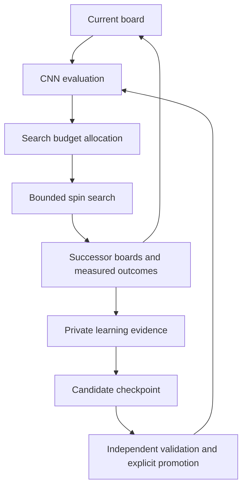

# Naga Eyes spin evaluator and observation analysis

Neyra separates public search from private CNN learning. Public GitHub Pages uses
the existing structural search evaluator. The developer-only learning Site uses
received bounded continuation observations to train an occupancy-only CNN.
It runs new continuation collection only when no received observations remain.

## Public search

- A fresh nonzero Web Crypto seed is generated on every page entry. A manually
  entered seed then remains reproducible for the run; saved seeds are not restored.
- Learning-data transmission defaults **off**, including when an old default-on
  preference is present. Only the current explicit, versioned consent enables
  transmission. Public learning is **off**. Old saved `cnn_evaluation` values do
  not enable it; a public CNN evaluator selector remains future work.
- Retained verified bag records may submit current rows, run/candidate identity,
  bag depth, seeds, rules, settings and a separate retained-path trace. These
  trace scores describe the heuristic search and never become CNN targets.
- With sharing on, selected verified boards after at least two bags seed the
  unchanged fixed-policy collector. Each job observes two further bags under
  its fixed work budget. Certified result boards enter a bounded global frontier
  ordered by depth, so origins can advance beyond the initial 2-to-4 window.
  The existing selected worker pool performs this work; no extra worker pool is
  created for public collection. Ordinary broad search resumes when no focused
  work remains or sharing is turned off.
- At origin bags two and three, each depth admits at most two broad roots and
  four total jobs per run, including certified descendants. These limits survive
  consent toggles. When those shallow opportunities are exhausted, ordinary
  search advances until deeper roots appear. Depth is always supported by actual
  certificates; the scheduler cannot guarantee a deeper field from every input.
- A previous retained board may start a **new** job after consent. Previous
  traces are not backfilled. Turning sharing off invalidates in-flight results,
  aborts upload and clears queued collection across open tabs. The synchronous
  collector may finish its current bounded CPU call, but that output is dropped.
- At most eight jobs/awaiting observations share the collection capacity. A
  descendant is not dispatched until its parent has been acknowledged by the
  relay. Retries retain FIFO observations; saturation pauses allocation instead
  of dropping a parent. Each observation is at most 512 KiB, sent alone in a v4
  envelope. Existing v3 trace batches remain compatible and separately bounded.
- The endpoint checks exact policy, source identity, work accounting, witness
  links and physical lock/line transitions. These are structural checks, not a
  fresh SRS/P7 execution. Received evidence remains **client-reported**.
- Bag-depth best/runner-up selection lives at the board's lower right. Public
  construction-probability readouts are omitted; probability settings, ranking
  and certificates remain in force. The focused view distinguishes relative
  future spins from a complete path's progress toward 40 clears.

## Private developer learning

[Neyra Learning Studio](https://neyra-learning-studio.daejun0311.chatgpt.site)
is owner-private. Data provision and learning are fixed **on**; there are no mode
selectors. Start/pause controls bound work without changing those modes.
The browser must remain open for its learning workers to run. GPU learning is a
separate default-off hardware preference and can change during a session.

The studio imports full focused observations, queues them for analysis and uses
those supplied results directly. It records CNN predictions and observed targets
without relabeling every received board. Only an empty received queue and empty
remote relay permit fallback collection. Fallback starts at an actual submitted
result field or its certified descendant, uses the same fixed collector, and
continues from its deeper result fields. No opener/bootstrap/perturbation examples
are automatically selected. Old seeded-order artifacts remain in historical
exports, but are not mixed into the active fixed-policy training set.

The active corpus is `public-results-v1`. Historical examples are excluded from
active counts, previews, collection and training, while their immutable proofs
and snapshots remain available for old model provenance. Board identity includes
the corpus before canonical occupancy hashing. The corpus activation endpoint
first previews actual retained public records, then requires that preview digest
when applying the migration. It does not manufacture sources for old examples.

Each session remains bounded. Two candidate workers train from the same retained
parent with different seeds, sharing the total epoch budget. Validation selects
between candidates and the unchanged parent. Test labels do not choose a winner.
Model records retain worker/backend details and training dataset provenance.

Sites D1 stores boards, source groups, fixed splits, observation indices, model
indices, training runs, search traces and decision records. R2 stores the full
observation witnesses, models and immutable export manifests.
A same-origin authenticated API supports collection, model uploads and complete
dataset exports.
The Site's existing service credential also permits agent uploads and readback;
it must never be copied into public code, command arguments, files or logs.

The served champion is pinned to `naga-spin-v2-f3194bf253a7`, independently of
newer private candidates. Training and uploads never promote a model automatically.
Private training checks a digest of the selected fixed-policy **training** records;
unchanged training data does not trigger another fit. New test, validation or
seeded records alone do not trigger training. A paused session stays paused.

The learning worker is a build-emitted asset resolved against the live HTTPS
origin. It must not use a server module's `file://` URL as its base. A narrowly
scoped recovery releases old jobs failed by that specific Worker-construction
error, without resetting unrelated collector failures or active leases.

## Occupancy-only inference

The model has **33,442 parameters**, including **21,056** in the convolutional
extractor. Input is a `1 × 24 × 10` occupancy tensor, bottom row first.
The lexicographically smaller board/reflection is used for geometric invariance;
this does not claim identical mirrored physical supply coverage.

| Layer | Shape |
| --- | --- |
| 3×3 convolution + ReLU | 1 → 24, padding 1 |
| 3×3 convolution + ReLU | 24 → 32, padding 1 |
| 3×3 convolution + ReLU | 32 → 48, padding 1 |
| Average pooling | 6×5 → 48×4×2 |
| Dense + ReLU | 384 → 32 |
| Output | 32 → 2 |

The two outputs are `foundSpinLikelihood` and `observedSpins`. They estimate
discovery under the model's fixed finite observation policy. They are not P7
construction probabilities, proven maxima or impossibility judgments.

Rust evaluates the model using ordinary CPU arithmetic, including in WASM.
Offline PyTorch and the private TensorFlow.js workers default to CPU. The Site
can dynamically load its WebGL backend for GPU learning. Each active fit finishes
before a changed GPU preference applies to the next fit; initialization/runtime
failure retries on CPU from the retained start model. Rust placement search stays
on CPU. Native PyTorch supports optional CUDA and ONNX Runtime supports optional
CUDA inference with the drain/fallback boundaries described below.
Neither public search ordering nor its archive exports automatically invoke CNN
evaluation. `learnedOrdering.enabled` remains false for compatibility.

## Fresh observation contract

Schema 2 has task `naga-spin-observations-v2`. The normal policy is
`neyra-fixed-bag-continuation-v2`; exploration uses
`neyra-seeded-bag-continuation-v2` with an explicit seed, ordinal and
`proposal-order-only` scope. The fixed collector and its source digest remain
unchanged. Both accept only current occupancy and provenance
from boundaries of at least two completed bags. Existing board scores, Terrain
scores, opener preferences, shape objectives and path-count targets are rejected.
The v2 model starts from fresh weights instead of a teacher-trained v1 checkpoint.

The labels are measured discovery of at least one spin and the observed count.
Input-reachable prefixes and exact P7/quiet-safe completed chains remain separate
in the evidence. Exhausted search is censored; an unobserved certificate maximum
stays unknown. Work, nodes, attempts, seed, horizon and labeling-source hash are
recorded so incomparable policies are not silently mixed.

Whole opener families and search runs remain in one train/validation/test split.
Descendants inherit their source group. Identical and reflected occupancy is
deduplicated within its corpus, while each stored physical witness retains its original
orientation. Checkpoint choice uses validation only; test records do not enter
gradient updates or browser checkpoint selection.

Retiring examples does not erase their historical split constraints. If a new
run's fixed split conflicts with a known physical or reflected board in any
retained corpus, the whole new run and its descendants are excluded from all
three learning splits. Raw analysis evidence remains available. The actual
`measurementGroup` is checked separately from a deduplicated board's original
provenance. New snapshots record these exclusions explicitly.

The browser dataset has a bounded recent-plus-coverage sample per split, with
explicit total and selected counts. New observations can therefore enter training
after the dataset grows beyond the per-session capacity.

## Decision evidence and future search loop

The current intermediate model estimates **bounded short-horizon discovery**.
The future completion-oriented loop can use the same convolutional extractor,
while preserving the current checkpoint and its observation contract:



This diagram is the direction of development, not a claim that adaptive budget
allocation or a 40L value model is already enabled. Current public search keeps
its structural evaluator, probability admission, mino limits and existing budget.
Private labels also keep a fixed declared work budget so their targets remain
comparable. A private job records at most two CNN evaluations: its supplied board
and one selected successor. Predictions, allocated work, consumed work and actual
outcomes are stored separately with the model and policy identity.

Measured successor results may be associated with an ancestor only through exact
physical board matches and certified bag bridges. Client-supplied bridges retain
client-reported trust; they do not become independently verified by import. Feedback retains witness
references, actual spins and locks across at most six bridges. It is a censored
lower bound on an observed path, not an optimal completion value or a replacement
for the ancestor's original two-bag label. Recording this feedback is distinct
from applying neural-network gradients; neither public heuristic scores nor
the CNN's own predictions become target truth.

For a future 40L cost head, the remaining required clears are known progress:
`remaining = 40 - completed`. Occupancy alone does not determine that progress:
two paths can reach the same board with different numbers of completed clears.
An estimate of minos needed to finish must therefore be conditioned on the
remaining target and the applicable rules. Training needs genuine completions
or an explicitly censored partial-observation objective; unfinished bounded
searches cannot supply exact completion costs. Until those contracts and
independent comparisons exist, keep the current mino-budget controls and avoid
adding ungrounded remaining-spin or completion-cost labels.

The retained v2 checkpoint can initialize a compatible private candidate without
discarding learned convolutional features. Future heads or a Transformer require
separate versioned contracts and sufficient independent evidence. No such
architecture change is required for collecting the present evidence.

## Reusable command-line tools

Build the release binaries with the repository's locked toolchain, then run the
commands with data and reports outside the repository:

```sh
cargo build --release --locked -p neyra-core --bins
python tools/learning/prepare.py --help
target/release/neyra-label --help
python tools/learning/train.py --help
python tools/learning/remote.py --help
```

`prepare.py` imports only deep occupancy/provenance, groups sources and removes
reflected duplicates. `neyra-label` collects new bounded continuations.
`spin_contract.py` validates observations, model dimensions and hashes.
`train.py` fits the network with CPU as the default and emits its model plus evaluation report.
`remote.py` uploads labels/models and checks the stored content by actual readback;
it also downloads full private snapshots, including proofs and search traces.
Use `NEYRA_SITE_URL` and `NEYRA_SITE_TOKEN` in the process environment for private
uploads. HTTPS certificate verification is required and redirects are refused.

The selected runtime checkpoint is
`crates/neyra-core/models/naga-spin-cnn-v2.json`. Its weight digest is SHA-256 over
the fixed sequence of float32 little-endian tensors, identified by
`sha256-f32le-neyraspin-v2`. JSON number formatting does not change that digest.
WASM exposes `evaluate_board`, `evaluate_board_model`, `spin_model_json`,
`label_board` and `label_board_exploration` for the private learning worker.

### Complete remote dataset refresh

The bounded browser training sample is not the export dataset. An export captures
committed rowid bounds and counts for the **active corpus** boards and labels, plus models,
training runs and traces. Later inserts appear in a new snapshot; earlier
snapshots remain available. Each new manifest records its corpus; manifests made
before corpus isolation retain their original meaning. Mutable job leases and retry counters are excluded.
Each manifest and page returns a SHA-256 of its exact UTF-8 bytes.

With the private URL/token already supplied through the process environment:

```sh
python tools/learning/remote.py sync --output /path/outside/repository/datasets
python tools/learning/remote.py pull --snapshot <snapshot-uuid> \
  --output /path/outside/repository/another-copy
```

The authenticated API is `POST /api/learning/exports`, followed by
`GET /api/learning/exports/{uuid}/manifest` and cursor pages at
`GET /api/learning/exports/{uuid}/page?kind=labels&cursor=0&limit=16`.
The downloader checks hashes, identity, cursor progress and final counts before
atomically updating `latest.json`. Partial downloads never become the latest
dataset; completed snapshot directories are never overwritten. Raw response
pages and per-kind JSONL files remain available for inspection. Fixed and seeded
labels are also written separately as `fixed-labels.jsonl` and
`exploration-labels.jsonl`; ordinary training uses only fixed labels. These derived
files honor the snapshot's `excludedTrainingGroups`, checking measurement and
source/run groups. Full `labels.jsonl`, raw pages and received artifacts remain
complete. The receipt records eligible/excluded counts and derived file hashes.
Old snapshots without this optional exclusion list preserve their prior meaning.

### Reusing a retained checkpoint

```sh
python tools/learning/train.py \
  --labels /path/outside/repository/fixed-labels.jsonl \
  --initial-model /path/outside/repository/parent-model.json \
  --initial-labels /path/outside/repository/parent-labels.jsonl \
  --model-output /path/outside/repository/candidate-model.json \
  --output /path/outside/repository/training-report.json
```

The original label file must match the parent's exact dataset digest. Repeated
fine-tuning also supplies each earlier lineage dataset with `--history-labels`.
The trainer checks unchanged observation policy and stable family, run-group and
reflected-board splits across all retained history. Only training records receive
gradients. Validation chooses a checkpoint, with the unchanged parent at epoch
zero eligible for selection. The test split is evaluated after selection and
never drives fitting or promotion. Save candidates to a new path; the trainer
refuses to overwrite an input artifact.

Offline datasets use a raw-JSONL SHA-256. Browser candidate datasets use an
explicitly tagged canonical-projection digest and retain ordered observation
references in their training runs, allowing reconstruction from a full export.
The current offline warm-start command accepts the raw-JSONL format only and
rejects browser candidates with a specific compatibility message. Browser
fine-tuning continues through the private worker; exported browser models and
their selection history remain preserved for a later compatible importer.

### Optional ONNX Runtime and CUDA

`requirements-cpu.txt` retains the CPU PyTorch default. Install the optional pinned
`requirements-onnx.txt` separately using the normal Python package index: the CPU
requirements use the PyTorch CPU index. The optional export environment requires
Python 3.12 or later.

```sh
python -m pip install -r tools/learning/requirements-cpu.txt
python -m pip install -r tools/learning/requirements-onnx.txt
python tools/learning/export_onnx.py \
  --model /path/outside/repository/retained-model.json \
  --boards /path/outside/repository/deep-boards.jsonl \
  --output /path/outside/repository/model.onnx --checks 32 --threads 2
python tools/learning/ort_inference.py \
  --model /path/outside/repository/model.onnx --threads 2
```

Export checks dynamic-batch CPU outputs against the retained JSON checkpoint and
writes an artifact/hash manifest. It never replaces the JSON or public model.
The ORT command accepts JSONL boards (`{"rows":[24 row masks]}`) or batches
(`{"boards":[...]}`). `{"control":{"gpu":true}}` requests CUDA; false requests CPU.
The Python `set_gpu_enabled` API can receive a toggle while work is active. The
current inference batch drains first; the next uses the new preference. Provider
initialization or execution failures retry the same inputs on CPU.

A CUDA host installs a compatible `onnxruntime-gpu` wheel **instead of** the CPU
`onnxruntime` wheel, never both. Match the installed CUDA and cuDNN versions to the
[official execution-provider requirements](https://onnxruntime.ai/docs/execution-providers/CUDA-ExecutionProvider.html).
Do not assume that a current GPU wheel matches an arbitrary PyTorch CUDA build.
A portable graph or provider listing alone is not evidence of GPU execution.

PyTorch training accepts `--threads 2` (1–16), optional `--gpu`, and
`--gpu-control /path/outside/repository/gpu-control.json`. The control file must
contain exactly `{"gpu":true}` or `{"gpu":false}` and should be replaced atomically.
Missing/malformed control requests CPU. The current epoch finishes before a new
preference applies. GPU failure restores pre-epoch model weights **and** Adam
optimizer state, then retries that epoch on CPU. Reports distinguish actual
epoch devices, availability and fallback; `device: "cpu"` in the JSON checkpoint
describes its portable inference contract, not where gradients ran.

ONNX Runtime export concerns inference. PyTorch and TensorFlow.js remain the
training backends; exporting a graph does not accelerate their backpropagation.
No GPU switch changes the frozen public checkpoint or Rust search physics.

## Public queue and private persistence

The public Pages origin cannot receive a private Site service credential.
`supabase/contribution-schema.sql`, `supabase/observation-schema.sql` and the
`neyra-contribute` Edge Function form
a bounded bridge: Pages submits inputs with separately tagged untrusted traces,
and full client-reported fixed-policy observations. The private Site pulls
them with a separate server-only consumer secret.

All queue/settings/quota tables enable RLS and deny anonymous/authenticated table
access. Only the ingress service can admit fields; only the private consumer can
pull or acknowledge them. Quotas bound batch size, daily volume and pending rows.
The v3 trace and v4 observation ingress require the current explicit consent envelope and reject older
default-on clients. A record key includes candidate identity and physical rows,
so different retained paths to one board keep their own evidence. Training
occupancy deduplication remains separate. Receipts include record key and depth
so an old acknowledgement cannot hide a newly promoted field. Supabase is the
transient queue; D1/R2 is the durable learning store. First-bag fields are
explicitly excluded by the private importer. Focused observations are FIFO,
identity-keyed and removed only after durable private import. Their independent
quota is 64 observations per run/day, 1,024 globally/day, at most 512 queued records
and 128 MiB of queued payload. Public table/RPC access remains denied.

The Site runtime needs `NEYRA_QUEUE_URL`, `NEYRA_QUEUE_ANON_KEY` and
`NEYRA_QUEUE_SECRET`. The public build contains only the endpoint and public anon
key. The consumer secret is stored privately and only its hash is retained in
the Supabase settings table. No database service-role key enters public code.

Datasets, new tests, one-time experiments and measured reports stay outside the
product repository. Reusable collection/training tools and the selected model
are versioned. Transformer work remains deferred until substantially larger,
independent data and evaluation evidence justify it.
