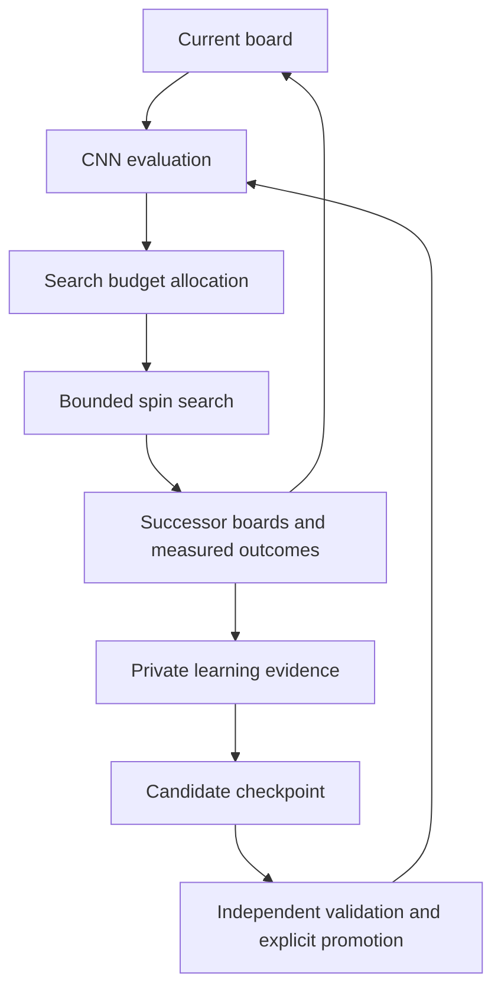

# CPU Naga Eyes spin evaluator

Neyra separates public search from private CNN learning. Public GitHub Pages uses
the existing structural search evaluator. The developer-only learning Site uses
fresh, bounded continuation observations to train an occupancy-only CNN.

## Public search

- A fresh nonzero Web Crypto seed is generated on every page entry. A manually
  entered seed then remains reproducible for the run; saved seeds are not restored.
- Learning-data transmission defaults **off**, including when an old default-on
  preference is present. Only the current explicit, versioned consent enables
  transmission. Public learning is **off**. Old saved `cnn_evaluation` values do
  not enable it; a public CNN evaluator selector remains future work.
- Only retained, verified completed-bag records are submitted. Inputs contain the
  current rows, run and candidate identity, bag depth, seed, rules and search
  configuration. With consent, a separate trace carries the actual final one or
  two bags of retained frames, the preceding board, heuristic observations,
  worker-wide work counters at that record, and the measured path outcome.
  Heuristic scores are observations about the search, never CNN target labels.
- Enabling transmission does not backfill records found before consent. Capture
  reuses existing frames and progress snapshots without extra search or sampling.
  Disabling it clears and aborts pending work, including across open tabs.
- The bounded queue batches at most eight fields within 24 KiB, prefers deeper
  fields and retries temporarily unavailable uploads. Each normalized field is
  limited to 6 KiB. Manual local exports remain independent of transmission.
- The public endpoint validates input and applies quotas. A client certificate
  claim is untrusted metadata; the private collector measures its own labels.

## Private developer learning

[Neyra Learning Studio](https://neyra-learning-studio.daejun0311.chatgpt.site)
is owner-private. Data provision and learning are fixed **on**; there are no mode
selectors. Start/pause controls limit CPU work without changing those modes.
The browser must remain open for its CPU worker to run.

The worker prioritizes nonempty boards after at least two completed bags. It
observes the next two or three bags under one declared policy, rather than
restarting the empty first bag or searching for an entire completion. A session
is bounded to three cycles, each with up to four label jobs and 20 training epochs.
At most one in four label jobs uses seeded proposal-order exploration, within
the same budget. Its observations keep a distinct policy and do not enter the
ordinary fixed-policy training set. Certified deeper boards discovered by either
policy may subsequently receive their own fixed-policy observations.
The initial model and offline collector use the same schema and can be run by an
agent without relying on an open browser tab.

Sites D1 stores boards, source groups, fixed splits, observation indices, model
indices, training runs, search traces and decision records. R2 stores the full
observation witnesses, models and immutable export manifests.
A same-origin authenticated API supports collection, model uploads and complete
dataset exports.
The Site's existing service credential also permits agent uploads and readback;
it must never be copied into public code, command arguments, files or logs.

The served champion is pinned to `naga-spin-v2-f3194bf253a7`, independently of
newer private candidates. Training and uploads never promote a model automatically.
Private training checks a digest of the selected fixed-policy **training** records;
unchanged training data does not trigger another fit. New test, validation or
seeded records alone do not trigger training. A paused session stays paused.

The learning worker is a build-emitted asset resolved against the live HTTPS
origin. It must not use a server module's `file://` URL as its base. A narrowly
scoped recovery releases old jobs failed by that specific Worker-construction
error, without resetting unrelated collector failures or active leases.

## Occupancy-only inference

The model has **33,442 parameters**, including **21,056** in the convolutional
extractor. Input is a `1 × 24 × 10` occupancy tensor, bottom row first.
The lexicographically smaller board/reflection is used for geometric invariance;
this does not claim identical mirrored physical supply coverage.

| Layer | Shape |
| --- | --- |
| 3×3 convolution + ReLU | 1 → 24, padding 1 |
| 3×3 convolution + ReLU | 24 → 32, padding 1 |
| 3×3 convolution + ReLU | 32 → 48, padding 1 |
| Average pooling | 6×5 → 48×4×2 |
| Dense + ReLU | 384 → 32 |
| Output | 32 → 2 |

The two outputs are `foundSpinLikelihood` and `observedSpins`. They estimate
discovery under the model's fixed finite observation policy. They are not P7
construction probabilities, proven maxima or impossibility judgments.

Rust evaluates the model using ordinary CPU arithmetic, including in WASM.
Offline learning uses CPU PyTorch; the private Site uses TensorFlow.js core,
layers and its CPU backend. No CUDA, WebGPU or WebGL backend is connected.
Neither public search ordering nor its archive exports automatically invoke CNN
evaluation. `learnedOrdering.enabled` remains false for compatibility.

## Fresh observation contract

Schema 2 has task `naga-spin-observations-v2`. The normal policy is
`neyra-fixed-bag-continuation-v2`; exploration uses
`neyra-seeded-bag-continuation-v2` with an explicit seed, ordinal and
`proposal-order-only` scope. The fixed collector and its source digest remain
unchanged. Both accept only current occupancy and provenance
from boundaries of at least two completed bags. Existing board scores, Terrain
scores, opener preferences, shape objectives and path-count targets are rejected.
The v2 model starts from fresh weights instead of a teacher-trained v1 checkpoint.

The labels are measured discovery of at least one spin and the observed count.
Input-reachable prefixes and exact P7/quiet-safe completed chains remain separate
in the evidence. Exhausted search is censored; an unobserved certificate maximum
stays unknown. Work, nodes, attempts, seed, horizon and labeling-source hash are
recorded so incomparable policies are not silently mixed.

Whole opener families and search runs remain in one train/validation/test split.
Descendants inherit their source group. Identical and reflected occupancy is
deduplicated globally, while each stored physical witness retains its original
orientation. Checkpoint choice uses validation only; test records do not enter
gradient updates or browser checkpoint selection.

The browser dataset has a bounded recent-plus-coverage sample per split, with
explicit total and selected counts. New observations can therefore enter training
after the dataset grows beyond the per-session capacity.

## Decision evidence and future search loop

The current intermediate model estimates **bounded short-horizon discovery**.
The future completion-oriented loop can use the same convolutional extractor,
while preserving the current checkpoint and its observation contract:



This diagram is the direction of development, not a claim that adaptive budget
allocation or a 40L value model is already enabled. Current public search keeps
its structural evaluator, probability admission, mino limits and existing budget.
Private labels also keep a fixed declared work budget so their targets remain
comparable. A private job records at most two CNN evaluations: its supplied board
and one selected successor. Predictions, allocated work, consumed work and actual
outcomes are stored separately with the model and policy identity.

Measured successor results may be associated with an ancestor only through exact
physical board matches and certified bag bridges. Feedback retains witness
references, actual spins and locks across at most six bridges. It is a censored
lower bound on an observed path, not an optimal completion value or a replacement
for the ancestor's original two-bag label. Recording this feedback is distinct
from applying neural-network gradients; neither public heuristic scores nor
the CNN's own predictions become target truth.

For a future 40L cost head, the remaining required clears are known progress:
`remaining = 40 - completed`. Occupancy alone does not determine that progress:
two paths can reach the same board with different numbers of completed clears.
An estimate of minos needed to finish must therefore be conditioned on the
remaining target and the applicable rules. Training needs genuine completions
or an explicitly censored partial-observation objective; unfinished bounded
searches cannot supply exact completion costs. Until those contracts and
independent comparisons exist, keep the current mino-budget controls and avoid
adding ungrounded remaining-spin or completion-cost labels.

The retained v2 checkpoint can initialize a compatible private candidate without
discarding learned convolutional features. Future heads or a Transformer require
separate versioned contracts and sufficient independent evidence. No such
architecture change is required for collecting the present evidence.

## Reusable command-line tools

Build the release binaries with the repository's locked toolchain, then run the
commands with data and reports outside the repository:

```sh
cargo build --release --locked -p neyra-core --bins
python tools/learning/prepare.py --help
target/release/neyra-label --help
python tools/learning/train.py --help
python tools/learning/remote.py --help
```

`prepare.py` imports only deep occupancy/provenance, groups sources and removes
reflected duplicates. `neyra-label` collects new bounded continuations.
`spin_contract.py` validates observations, model dimensions and hashes.
`train.py` fits the CPU network and emits its model plus evaluation report.
`remote.py` uploads labels/models and checks the stored content by actual readback;
it also downloads full private snapshots, including proofs and search traces.
Use `NEYRA_SITE_URL` and `NEYRA_SITE_TOKEN` in the process environment for private
uploads. HTTPS certificate verification is required and redirects are refused.

The selected runtime checkpoint is
`crates/neyra-core/models/naga-spin-cnn-v2.json`. Its weight digest is SHA-256 over
the fixed sequence of float32 little-endian tensors, identified by
`sha256-f32le-neyraspin-v2`. JSON number formatting does not change that digest.
WASM exposes `evaluate_board`, `evaluate_board_model`, `spin_model_json`,
`label_board` and `label_board_exploration` for the private learning worker.

### Complete remote dataset refresh

The bounded browser training sample is not the export dataset. An export captures
committed rowid bounds and counts for **all** retained boards, labels, models,
training runs and traces. Later inserts appear in a new snapshot; earlier
snapshots remain available. Mutable job leases and retry counters are excluded.
Each manifest and page returns a SHA-256 of its exact UTF-8 bytes.

With the private URL/token already supplied through the process environment:

```sh
python tools/learning/remote.py sync --output /path/outside/repository/datasets
python tools/learning/remote.py pull --snapshot <snapshot-uuid> \
  --output /path/outside/repository/another-copy
```

The authenticated API is `POST /api/learning/exports`, followed by
`GET /api/learning/exports/{uuid}/manifest` and cursor pages at
`GET /api/learning/exports/{uuid}/page?kind=labels&cursor=0&limit=16`.
The downloader checks hashes, identity, cursor progress and final counts before
atomically updating `latest.json`. Partial downloads never become the latest
dataset; completed snapshot directories are never overwritten. Raw response
pages and per-kind JSONL files remain available for inspection. Fixed and seeded
labels are also written separately as `fixed-labels.jsonl` and
`exploration-labels.jsonl`; ordinary training uses only fixed labels.

### Reusing a retained checkpoint

```sh
python tools/learning/train.py \
  --labels /path/outside/repository/fixed-labels.jsonl \
  --initial-model /path/outside/repository/parent-model.json \
  --initial-labels /path/outside/repository/parent-labels.jsonl \
  --model-output /path/outside/repository/candidate-model.json \
  --output /path/outside/repository/training-report.json
```

The original label file must match the parent's exact dataset digest. Repeated
fine-tuning also supplies each earlier lineage dataset with `--history-labels`.
The trainer checks unchanged observation policy and stable family, run-group and
reflected-board splits across all retained history. Only training records receive
gradients. Validation chooses a checkpoint, with the unchanged parent at epoch
zero eligible for selection. The test split is evaluated after selection and
never drives fitting or promotion. Save candidates to a new path; the trainer
refuses to overwrite an input artifact.

Offline datasets use a raw-JSONL SHA-256. Browser candidate datasets use an
explicitly tagged canonical-projection digest and retain ordered observation
references in their training runs, allowing reconstruction from a full export.
The current offline warm-start command accepts the raw-JSONL format only and
rejects browser candidates with a specific compatibility message. Browser
fine-tuning continues through the private worker; exported browser models and
their selection history remain preserved for a later compatible importer.

## Public queue and private persistence

The public Pages origin cannot receive a private Site service credential.
`supabase/contribution-schema.sql` and the `neyra-contribute` Edge Function form
a bounded bridge: Pages submits inputs with separately tagged untrusted traces,
and the private Site pulls
them with a separate server-only consumer secret.

All queue/settings/quota tables enable RLS and deny anonymous/authenticated table
access. Only the ingress service can admit fields; only the private consumer can
pull or acknowledge them. Quotas bound batch size, daily volume and pending rows.
The v3 ingress requires the current explicit consent envelope and rejects older
default-on clients. A record key includes candidate identity and physical rows,
so different retained paths to one board keep their own evidence. Training
occupancy deduplication remains separate. Receipts include record key and depth
so an old acknowledgement cannot hide a newly promoted field. Supabase is the
transient queue; D1/R2 is the durable learning store. First-bag fields are
explicitly excluded by the private importer.

The Site runtime needs `NEYRA_QUEUE_URL`, `NEYRA_QUEUE_ANON_KEY` and
`NEYRA_QUEUE_SECRET`. The public build contains only the endpoint and public anon
key. The consumer secret is stored privately and only its hash is retained in
the Supabase settings table. No database service-role key enters public code.

Datasets, new tests, one-time experiments and measured reports stay outside the
product repository. Reusable collection/training tools and the selected model
are versioned. Transformer work remains deferred until substantially larger,
independent data and evaluation evidence justify it.
